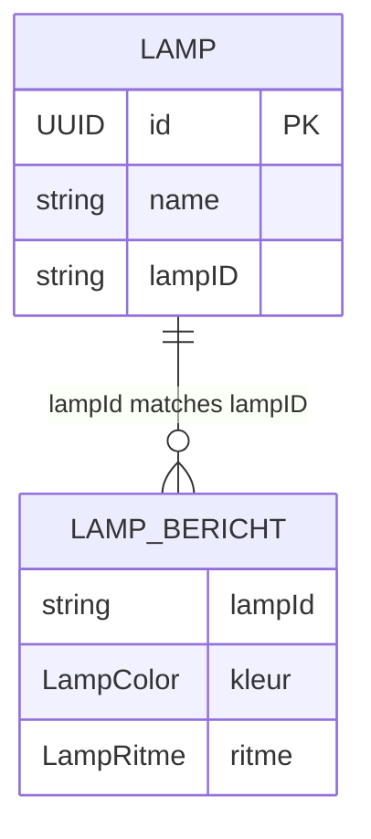

# Datamodellen van Denk Aan Jou

Deze pagina beschrijft de belangrijkste modellen in de app.

## `Lamp`

Bestand: `Denk_Aan_Jou/Models/Lamp.swift`

```swift
@Model
class Lamp{
    var id: UUID
    var name: String
    var lampID : String

    init(id: UUID = UUID(), name: String = "", lampID:String) {
        self.id = id
        self.name = name
        self.lampID = lampID
    }
}
```

Dit model vertegenwoordigt een lokale lamp:

- `id`: unieke identifier
- `name`: naam van de lamp
- `lampID`: ID die gebruikt wordt om de lamp te identificeren

Deze entiteit wordt in SwiftData opgeslagen.

## `LampBericht`

Bestand: `Denk_Aan_Jou/Models/LampBericht.swift`

```swift
@Observable
class LampBericht{
    var lampId : String
    var kleur : LampColor
    var ritme : LampRitme

    init(lampId: String, kleur: LampColor, ritme: LampRitme) {
        self.lampId = lampId
        self.kleur = kleur
        self.ritme = ritme
    }
}
```

Dit model beschrijft het bericht dat naar een lamp kan worden gestuurd.

- `lampId`: lamp-identifier
- `kleur`: kleur van de lamp
- `ritme`: ritme of animatie van de lamp

## `LampColor`

Bestand: `Denk_Aan_Jou/Enums/LampColor.swift`

```swift
enum LampColor : Hashable{
    case Red
    case Blue
    case Green
}
```

Huidige kleuren:
- Red
- Blue
- Green

## `LampRitme`

Bestand: `Denk_Aan_Jou/Enums/LampRitme.swift`

```swift
enum LampRitme : Hashable{
    case rustig
}
```

Op dit moment is het ritme beperkt tot één waarde: `rustig`. In de toekomst kan dit uitgebreid worden met waarden zoals `pulse`, `blink`, `fade`, etc.

## Schema en relatie

Er is ook een ER-diagram toegevoegd in `doc/erd.mmd`:



Dit laat zien dat de app bedoeld is om:

- een lamp op te slaan
- daarna een bericht te maken met kleur en ritme
- dat bericht te koppelen aan dezelfde lamp

## Schema-documentatie

In `docs/lamp_schema.sql` staat een schemavoorstel voor de lamp data. Dit is handig als je de lokale SwiftData-modellen wilt afstemmen op een backend of database.

## Belangrijke kanttekening

De modellen vormen een goede basis, maar ze zijn nog niet compleet voor een volledige productieapp. Vooral `LampRitme` en het netwerkverkeer zijn nog erg eenvoudig.
